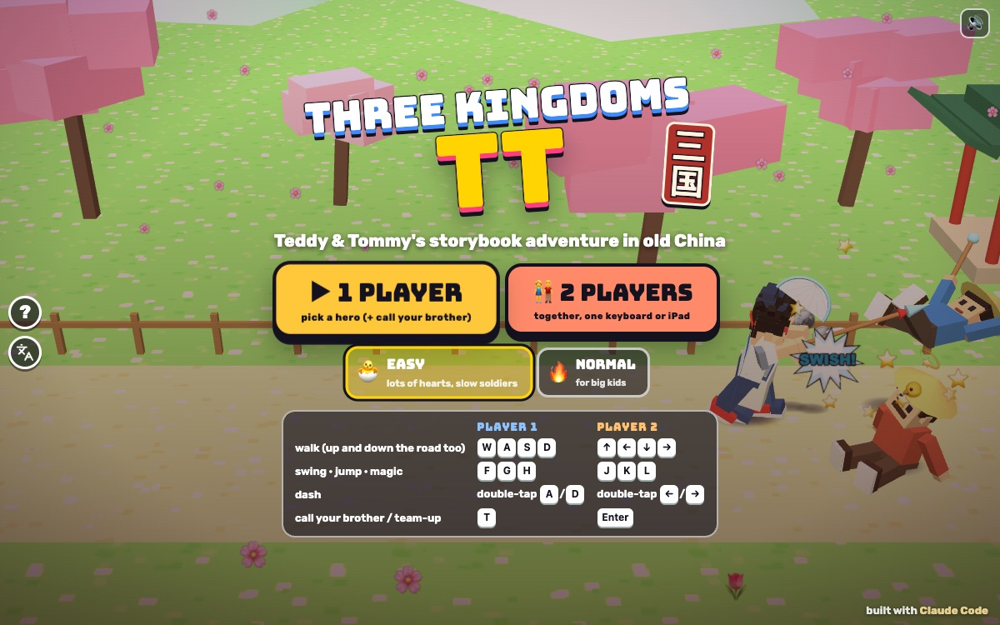

# Three Kingdoms TT

[](https://adong.github.io/three-kingdoms-tt/)

Press **?** any time (or tap the round **?** button on the left edge) to see the keys. The game waits while you look.
Tap the language button under it (the A文 icon) to switch between English and 中文; the dashboard and every game remember the choice.

A Three Kingdoms beat-'em-up starring Teddy and Tommy: a side-scrolling storybook through the old story of the Three Kingdoms (the novel and the history, hundreds of years old), with foam weapons, magic, horses, treasure chests and jar-smashing bonus rounds. Six stages, two bonus rounds, six heroes, 1 or 2 players.

**中文：** Teddy 和 Tommy 的三国故事书闯关游戏：泡沫武器、法术、骑马、宝箱，还有砸罐子奖励关。6 关加 2 个奖励关，6 位英雄，单人或双人。

It's silly, never gory. The weapons are foam and the army wears straw hats. A bonked hero loses a heart. A beaten soldier sits down dizzy with stars round his head, drops his coins and either runs off home or pops into stars. The generals wave a white flag and run away. Nobody gets hurt for real.

It's built with Claude Code from plain JavaScript and Three.js on the shared Claude Games kit. There are no image, model or audio files: everyone is a blocky kit character in a costume made of boxes, every texture is painted on a canvas, and every sound is synthesised. The name lives in one place, `js/title.js`, so it's a one-line rename.

## Play

- **Double-click `index.html`.** It works offline: Three.js and the kit are copied into `kit/`. Without internet the title font falls back to Arial Black.
- **Send one file:** `dist/three-kingdoms-tt.html` is the whole game in one page. AirDrop or email it, then open it in a browser.
- **Rebuild that file** after any edit:

  ```bash
  python3 kit/tools/bundle.py . --name three-kingdoms-tt
  ```

**1 PLAYER:** pick one of six heroes. Your brother is one tap away (see *Companion*).
**2 PLAYERS:** player 1 picks a hero, then player 2. Play on one keyboard, or side by side on one iPad.

Each stage starts with a storybook card: the chapter's name in Chinese and English, a picture line and a few sentences of the story. The first stage teaches the moves with little hints as you go.

## Controls

| | Player 1 | Player 2 | Touch |
|---|---|---|---|
| walk (left/right and up/down the road) | W A S D | ← → ↑ ↓ | joystick |
| swing your weapon (a 3-hit combo) | F | J | ⚔️ SWING |
| jump (jump, then swing = flying kick) | G | K | ⬆️ JUMP |
| magic (uses one 🔮) | H | L | ✨ MAGIC |
| rescue spin (costs a heart, never the last) | hold F and press G (either order; works mid-swing or while bonked), or magic with no 🔮 left | J + K | ⚔️ + ⬆️ together, or ✨ with no 🔮 |
| dash (swing while dashing = dash attack) | double-tap A or D | double-tap ← or → | flick the joystick sideways twice |
| grab and toss | walk into a soldier, then F F F | walk into a soldier, then J J J | walk in, then ⚔️ ⚔️ ⚔️ |
| call a horse | R | O | 🐎 HORSE |
| ride a horse · hop off | walk to it · G | walk to it · K | walk to it · ⬆️ |
| on a horse: scoop a soldier up · fling him | swing next to him · swing again | J · J | ⚔️ · ⚔️ |
| call your brother (1P) / team-up (2P) | T | Enter | tap his face (1P) or TEAM-UP! (2P) |

- In 1 player both key sets drive you, and Space jumps too.
- **P** or Esc pauses and **M** turns the sound on or off. The ❚❚ and 🔊 buttons at the top do the same.
- **Menus:** on the title, Enter (or F/J) starts 1 player and 2 starts 2 players. ← → switch EASY/NORMAL, and S opens the stage list once you've cleared a stage. On the hero screen use the arrows and Enter, and Esc goes back.
- **Touch:** the joystick and buttons appear on the first touch. In 2 players, player 1's controls are on the left and player 2's on the right.

**On the road:**

- **Hearts:** every bonk costs one heart. Lose them all and you lose a life, plus one star of weapon level.
- **Treasure chests:** bonk one open for a weapon upgrade (⚔️: foam blue, then silver, then glowing gold; each level hits harder and reaches further), a 🔮, coins, a gold ingot or food.
- **Food:** 包子 bao bun (+2 hearts), 鸡腿 drumstick (+3) and 寿桃 longevity peach (all your hearts). Beaten soldiers sometimes drop some.
- **🔮 Magic:** start with 3 on Easy (up to 5) or 2 on Normal (up to 3). Every few soldiers you send home fills one back up.
- **Horses:** some stages have a toy horse waiting, and you can **call one any time with R** (O for player 2, or the 🐎 button): it gallops in from behind and you hop on. One at a time, then a short wait before the next call (4 s on Easy, 10 s on Normal); the 🐎 chip and button go grey while you wait. Riding, you're faster, your swing is a big sweep from the saddle, and galloping into soldiers bowls them over (CLIP-CLOP!). Swing right next to a soldier to **scoop him up by the collar**: he dangles beside the horse kicking his legs, every bump of the gallop costs him (BUMP!), and he bowls over anyone you swing him into; swing again (or wait 3 s) to fling him. A bonk knocks you off but costs no heart; the horse trots home. Jump to hop off: the horse waits for you, and you climb back on once you've stepped away and walked back to it. If you're riding when you call your brother (or get on a horse while he's there), he rides too.
- **Coins** fly into your pocket by themselves.

## Heroes

Pick one, or two in 2 players. Each has a foam weapon, a 3-hit combo and their own magic.

| Hero | Inspired by | Weapon and combo | Magic |
|---|---|---|---|
| **TEDDY** · The Dragon Spear (龙枪小英雄) | Zhao Yun: red headband, silver armour, blue cape | spear: his Tyson **jab**, **straight**, then a sweep | **DRAGON DUNK!** (神龙灌篮): his 🏀 jump shot, slammed down in a big ring |
| **TOMMY** · The Little Strategist (小军师) | Zhuge Liang: scholar's hat, white robe | feather fan: fan, fan, gust of wind | **FEATHER-FAN GALE!** (羽扇狂风): his ✌️ Y pose, then two whirlwinds sweep the whole screen |
| **ZOOM** · The Roaring Spear (吼声猛将) | Zhang Fei: big black beard | snake spear: thrust, thrust, chop | **THUNDER ROAR!** (雷霆怒吼): a lightning bolt on every soldier on screen |
| **LUNA** · The Moon Princess (月亮公主) | Sun Shangxiang: red robe, gold hairpin | twin swords: slash, slash, a spin that hits both sides | **FIRE SWIRL!** (火焰旋风): a ring of fire all around her |
| **BOLT** · The Wooden-Ox Bot (木牛机器人) | the wooden ox (木牛流马): horns and wooden armour | foam hammer: bonk, bonk, SLAM | **REPEATING CROSSBOW!** (诸葛连弩): five foam darts across the screen |
| **BRUNO** · The Bearded General (美髯熊将军) | Guan Yu: long beard, green robe | green-dragon blade: cut, cut, crescent | **GREEN DRAGON WAVE!** (青龙偃月波): a giant moon-shaped wave rolls forward |

Teddy and Tommy are the kit's characters modelled on the boys, in costume. Zoom, Luna, Bolt and Bruno are the kit's friends.

## Stages

A storybook in eight chapters. Clear one to open the next; the stage list (📖) lets you replay any you've opened.

| | Stage | Story | General |
|---|---|---|---|
| 1 | 🌸 THE PEACH GARDEN OATH · 桃园结义 | Three heroes promise to help everyone under the peach blossoms. The tutorial: hints teach each move. | SERGEANT STRAW (草帽大兵长) |
| 2 | 💛 THE YELLOW TURBANS · 黄巾之乱 | A sneaky wizard turned everyone into yellow-scarf zombies. The first horse. | YELLOW TURBAN WIZARD (黄巾大法师): calls thunder |
| 3 | 🐯 SHOWDOWN AT TIGER GATE · 大战虎牢关 | The big fortress gate, and Lü Bu with his two giant feathers. | MIGHTY LÜ BU (无敌吕布): charges, stomps, sweeps |
| ★ | 🏺 BONUS: SMASH THE JARS · 砸罐子 | 18 jars of coins in a courtyard. Smash them before the incense stick burns down (25 s). Smash all for a PERFECT bonus. | |
| 4 | 🌉 THE BRIDGE AT CHANGBAN · 长坂坡 | A wooden bridge over the river, two horses, clockwork soldiers. | GENERAL CLANK (铁甲大将军): an iron robot |
| 5 | 🔥 FIRE AT THE RED CLIFFS · 火烧赤壁 | Run across the chained boats while the east wind blows. | GRUMPY CAO CAO (生气的曹操): throws paper lanterns |
| ★ | 🏮 BONUS: LANTERN NIGHT · 元宵灯会 | Jars full of coins and gold under the festival lanterns. | |
| 6 | 🏯 THE EMPTY CITY TRICK · 空城计 | The gates are open and music plays on the wall. The last fight. | SNEAKY SIMA YI (狡猾的司马懿): swoops, throws scrolls |

**The army:** straw-hat soldiers with foam sticks, pea-shooters who throw foam peas from a distance, yellow-turban zombies who wobble in for a hug, and clockwork soldiers. Every attack shows a yellow **!** first, so there's time to step out of the way, and only a few attack at once.

Every stage ends with both heroes' signature moves (Teddy's jab-straight and 🏀 jump shot, Tommy's ✌️ Y; friends wave) and a HIGH FIVE.

## Companion

**1 player: call your brother.** Press **T** (or tap his big face at the top right) any time, as often as you like. Tommy comes for everyone; Teddy comes when Tommy is the one playing (`Kit.roster.buddyFor`).

- He gallops in on a little white horse at his buddy size and hops off.
- He says hi with his signature move: Tommy's ✌️ Y pose, or Teddy's jab and straight. It bonks anyone close.
- He brings a treat (+2 hearts): 包子 bao bun, 寿桃 longevity peach, 🍦 💧 🧃 🍪 🍉 or 🍌.
- While he's there he **blocks every hit**: "TOMMY SAVED YOU!" (or "TEDDY SAVED YOU!"). His bar shows how long he'll stay (10 s).
- He fights beside you, then says bye with his signature and runs off. Calling him again while he's there brings another treat and a full new visit.

**2 players: TEAM-UP!** Press **T** or **Enter** (or tap TEAM-UP!) when the button glows: both heroes strike together and bonk the whole screen. It needs a rest after (15 s on Easy, 25 s on Normal).

## Modes

- **🐣 EASY** (the default), for Tommy (5):
  - 8 hearts, 5 lives, and as many continues as you like.
  - Fewer soldiers (a third of each wave stays home), only one attacks at a time, and they're slower.
  - Every soldier shows its **!** for longer and has 60% of the health; the generals have 55%.
  - 3 magic 🔮 to start, up to 5, refilling faster.
- **🔥 NORMAL**, for Teddy (8): 5 hearts, 3 lives, 2 continues, up to two soldiers attack at once, 2 🔮 (up to 3).
- **1 or 2 players**, on a keyboard, a phone (landscape) or an iPad (2 players side by side).
- **English or 中文**, switched live with the A文 button. Stage names, story cards, hero titles and the generals all have Chinese names; in English the Chinese names show too, as decoration.

**Testing:** the rules are plain JavaScript with no Three.js (`js/sim.js`, `js/brains.js`), so an autopilot plays them headless.

```bash
node tools/check.js --prove
```

That runs 46 single-move checks (every hero's combo and magic, grab and toss, chests, food, horses and calling one, the companion blocking every hit, team-up, continues, the bonus timer), then the autopilot through every stage, bonus round and general in 11 set-ups (each hero, Easy and Normal, 1P and 2P, with and without the companion, calling horses, and a sloppy "kid" autopilot that never uses magic), and finally proves the check can fail (an idle player must not clear stage 1; a soldier pushed off-screen must be caught). Add `--soak 3` for 3 extra random seeds per run. In the browser, `game.soak()`, `game.moves()` and `game.prove()` run the same checks, and `game.start({ stage, hero, mode, difficulty })` with `game.step(seconds)` drives a real stage frame by frame.

## Not verified

- **Sound:** the synth code runs without errors, but nobody has listened to it.
- **Real touch devices:** the joystick and buttons, in 1P and the 2-player iPad layout, were checked with simulated touch at phone (740x360) and iPad (1024x768) sizes in a desktop browser, not on a real phone or iPad. Two kids pressing at once on one iPad is untested.
- **Real kids:** the difficulty comes from the autopilots, not from Teddy and Tommy playing. On Easy the sloppy "kid" autopilot clears every stage without a continue; on Normal it sometimes needs one.
- **Long real-time play:** tests step the game by hand; a full playthrough in real time hasn't been watched.
- **Double-click from Finder:** both `index.html` and `dist/three-kingdoms-tt.html` were opened as `file://` pages in headless Chrome (booted, played, no page errors), but not by double-clicking in Finder, and not with the network switched off.
